# UNFILED-

### THE HOLLOW BROADCAST
**ISSUE 00 / MMXXVI**

> A field guide to messages that arrive after their senders have gone.

[OPEN THE TRANSMISSION →](https://dmitrylelee.github.io/UNFILED-/)

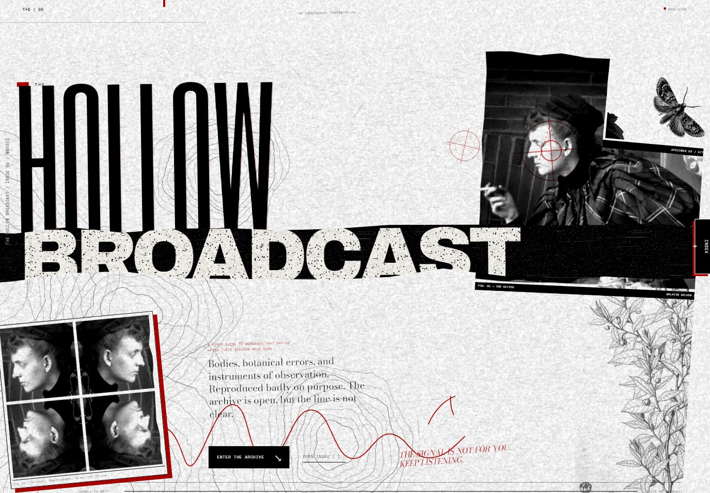

This is not a portfolio. It is not a landing page. It is not a place to
"discover my work."

It is an independent transmission: a fictional archive assembled from
public-domain plates, torn paper, photocopier dust, red corrections, damaged
photographs and several wrong decisions made on purpose. The site is a static
publication, but it behaves like a physical object that has been scanned badly
and left online.

The archive is open. The line is not clear.

---

## WHAT THIS IS

**UNFILED-** is the repository. **THE HOLLOW BROADCAST** is the object inside it.

The publication is built as a sequence of graphic compositions rather than a
stack of website sections. Every section has its own proportions, tears, type
scale, noise and rules of assembly. Some pages are broadsides. Some are contact
sheets. Some are faxes, studio boards, or the back cover of something that
should have stayed in a drawer.

The material is deliberately inconsistent:

- black paper and overexposed photography
- white paper and scanner stains
- deep red ink and handwritten interventions
- huge condensed headlines and tiny archival labels
- clean diagrams next to badly damaged surfaces
- interfaces that look borrowed from an obsolete machine

Nothing here is meant to look untouched.

---

## THE CONTENTS

### 00 / ENTRANCE
A title, a sitter, four exposures, a moth, a botanical error, and a signal that
will not identify itself. The entrance is the cover and the first wrong turn.

### 01 / SPECIMENS
Seven public-domain plates and four original ink plates recovered from a damaged external drive. Bodies,
botanical errors and instruments of observation, reproduced badly on purpose.
Click a plate to open its file.

### 02 / THE CUTTING TABLE
An interactive composition board. Nine scraps of evidence can be dragged,
turned, shuffled and reset. There is no original arrangement. There is only the
one you leave behind.

### 03 / FRAGMENTS
Notes for a black broadside. The room was empty, but the microphone kept
breathing.

### 04 / APPARATUS
A small machine for making decisions you will later deny. Generate a sigil, read
its designation, save the SVG, or bury it.

### 05 / FREQUENCIES
Four synthesized carriers. No mp3s, no streaming service, no end of track.
Headphones recommended; silence also acceptable.

### 06 / TRANSMISSIONS
A local fax machine and a log of messages from an unknown sender. Nothing is
sent anywhere. Nothing survives after the window closes.

### 07 / OTHER WORLDS
Six real doorways out of this building. They are not affiliated with the
broadcast. The internet is still a place you can get lost in.

### A / CULTURAL RESIDUE
An appendix of nine objects borrowed from the world's shared memory, stripped of
their original images and filed under residue. The references are textual; the
drawings are original. The stories are still missing their endings.

### B / THE MAP ROOM
Six coordinates, one invented coastline, and an interactive field map. Select a
marker to open its note; trace the route if you trust the red line.

### C / LAST THINGS
An ossuary of borrowed bones and a lost 35mm reel with missing frames. Built
around a 1543 Vesalius skeleton and an original film-strip player.

### 08 / COLOPHON
Plates, type, machine notes and the end of the transmission.

---

## HOW TO READ IT

There is no correct order, but there is an index.

- Open the **INDEX** tab at the right edge, or press `I`.
- Click any specimen to open its file. The reader now holds eleven plates, including THE HAND, THE WHEEL, THE SPIRAL, and the yellow ERRATA insert.
- In Fragments, press **CUT THE TEXT** to assemble a new line from a local fragment pool.
- Drag the scraps on **The Cutting Table**; use `SHUFFLE THE TABLE`, `TURN 15°` and `RESET`.
  With a scrap focused, arrow keys nudge it, `[` and `]` rotate it, and `Shift` makes nudges larger.
- Press **DRAW A MARK** in Apparatus to generate a new sigil, then **SAVE SVG** if you want to keep it.
- Select a frequency and press play. Sound is generated live in the browser.
- Press **ROOM TONE [S]** at the right edge, below the index tab, for a low, synthesized room hum. It starts only on click and can be stopped at any time.
- Open the index to switch **SOUND FX** on or off, or press `F`. Interface sounds are synthesized locally: paper, static, stamp and a short ping. Nothing is loaded and nothing autoplays.
- Open **CULTURAL RESIDUE** from the index or scroll to the appendix. Click a relic to open its file; use previous/next inside.
- In **THE MAP ROOM**, select any numbered marker to read a field note, press **TRACE THE ROUTE** to move through all six coordinates, or press **TRACE THE BLUE ROUTE** for the unauthorised ink-test route.
- In **Specimens**, the yellow **ERRATA** insert opens PLATE 11, printed in the wrong ink.
- In **LAST THINGS**, run the lost reel; click any frame to inspect it. Two frames are missing and stay missing.
- Press **RECEIVE TRANSMISSION** in Transmissions. Do not reply.
- Touch the moth three times. It is not a button.

The index scrolls. The page is longer than it looks.

---

## THE MATERIALS

The visual layer is original. It was not applied as a filter over a finished
layout; the paper had to be torn first.

- torn section masks and ripped image silhouettes
- black toner, white scratches, copier streaks and scanner dust
- paper fibres, ink dropout, halftone dots and smudged ink
- transparent tape, paper scraps and red hand-drawn marks
- four self-hosted typefaces: Six Caps, Archivo Black, Bodoni Moda, Space Mono
- public-domain and CC0 plates, recomposed and converted to high-contrast monochrome
- no stock photography, no tracking pixels, no external APIs

All textures, paper silhouettes, tape, scratches and hand-drawn marks live in
[`the-hollow-broadcast/assets/`](the-hollow-broadcast/assets/). The construction
notes are in [`the-hollow-broadcast/README.md`](the-hollow-broadcast/README.md).

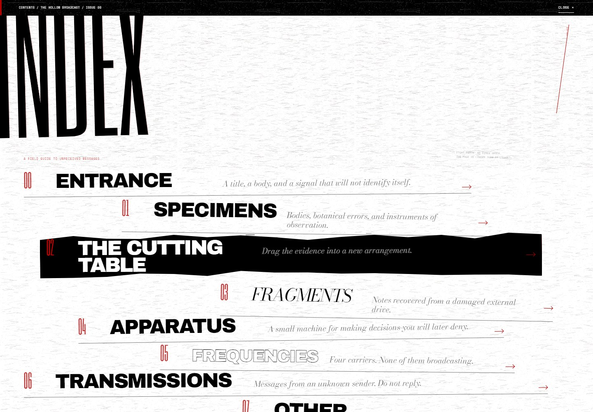

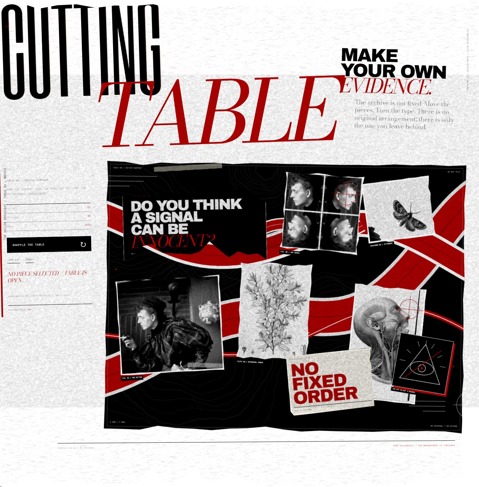

---

## THE OBJECT IN FRAMES

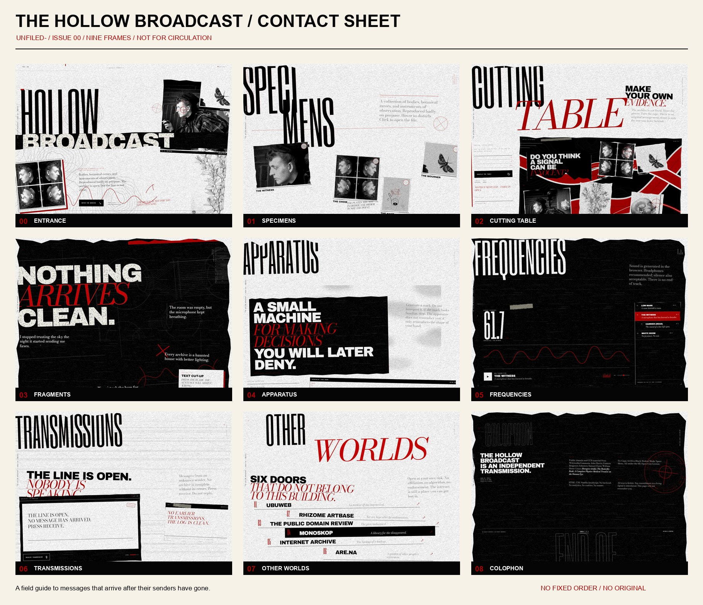

A contact sheet from the rendered publication. The whole object, cut into nine frames.

Individual frames:
[00 Entrance](previews/00-entrance.jpg) ·
[01 Specimens](previews/01-specimens.jpg) ·
[02 Cutting Table](previews/02-cutting-table.jpg) ·
[03 Fragments](previews/03-fragments.jpg) ·
[04 Apparatus](previews/04-apparatus.jpg) ·
[05 Frequencies](previews/05-frequencies.jpg) ·
[06 Transmissions](previews/06-transmissions.jpg) ·
[07 Other Worlds](previews/07-other-worlds.jpg) ·
[08 Colophon](previews/08-colophon.jpg) ·
[Mobile](previews/mobile.jpg)

### ORIGINAL PLATES / PL. 08—11

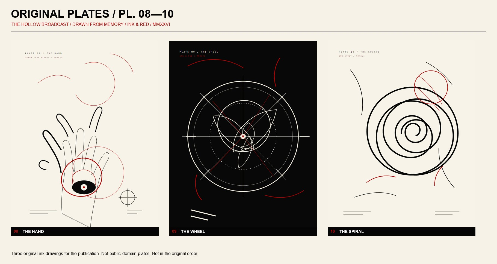

Four ink drawings made for this publication, not sourced from an archive:
**THE HAND**, **THE WHEEL**, and **THE SPIRAL**. All three now open in the
specimen reader. The catalogue has grown from seven plates to eleven.

### FIELD TOOL / TEXT CUT-UP

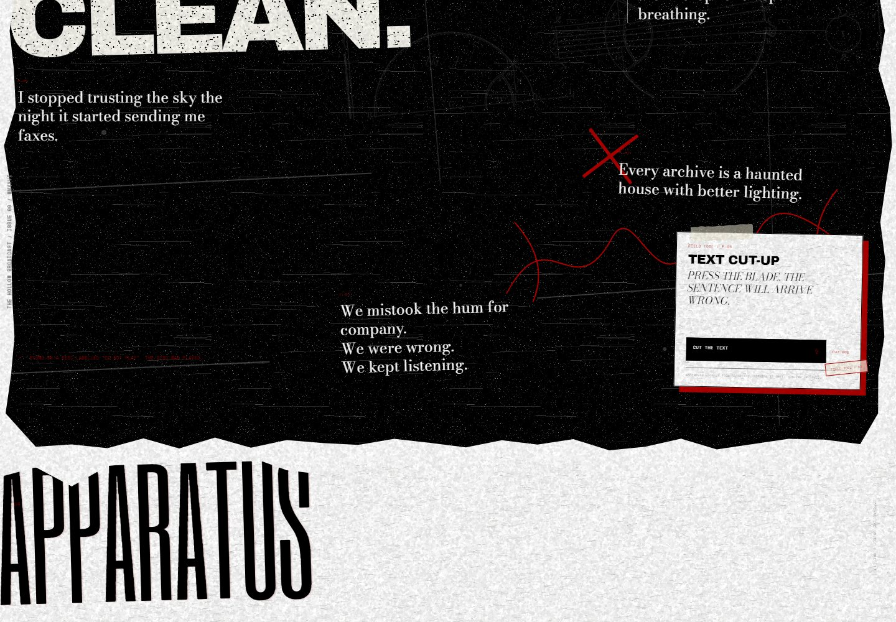

A new instrument in **Fragments**. Every press of **CUT THE TEXT** reassembles a
sentence from local fragments. After the third cut it starts talking back. The
tool is local only: no saving, no sending, no account.

### APPENDIX A / CULTURAL RESIDUE

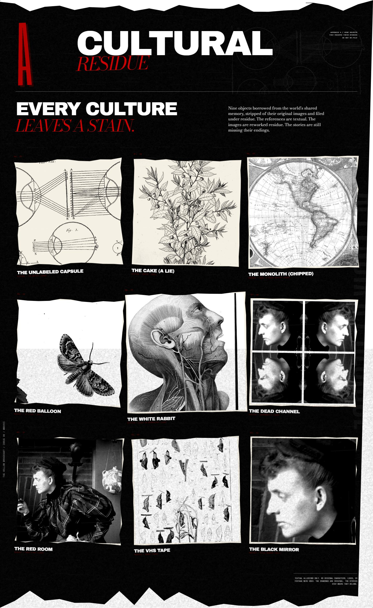

Nine relics, nine references, one filing error. The appendix is part of the
publication, not a bonus page.

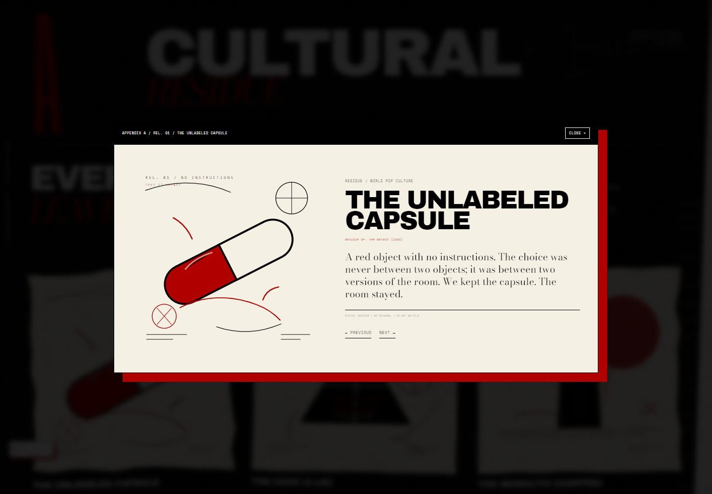

### APPENDIX B / THE MAP ROOM

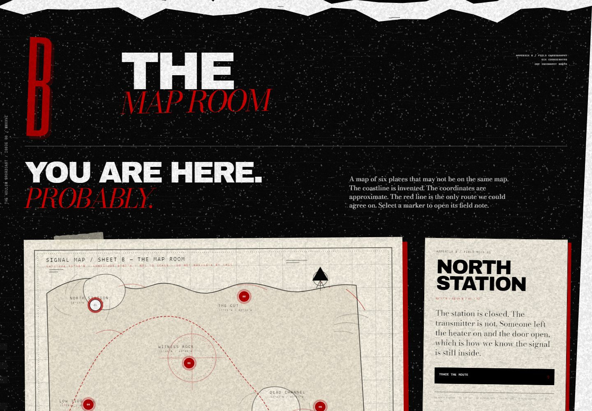

An interactive field map with six coordinates, an invented coastline, and a
route that does not agree with the scale.

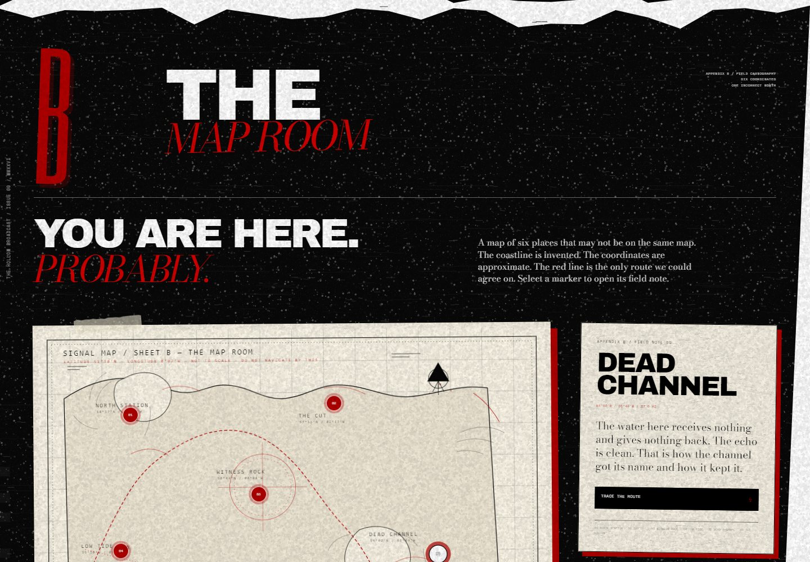

### THE TWO WRONG PAGES

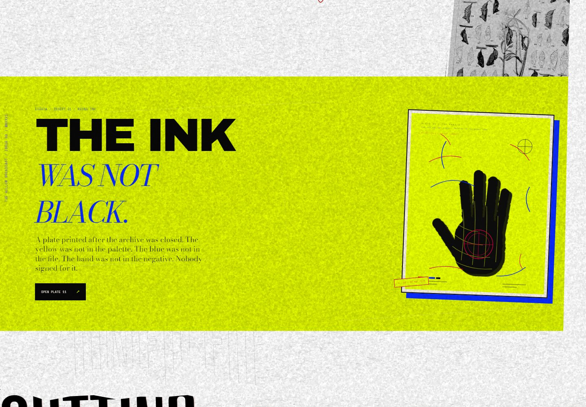

A wrong-ink insert pasted into the specimen archive: acid yellow, hand-drawn,
blue and red, deliberately outside the palette.

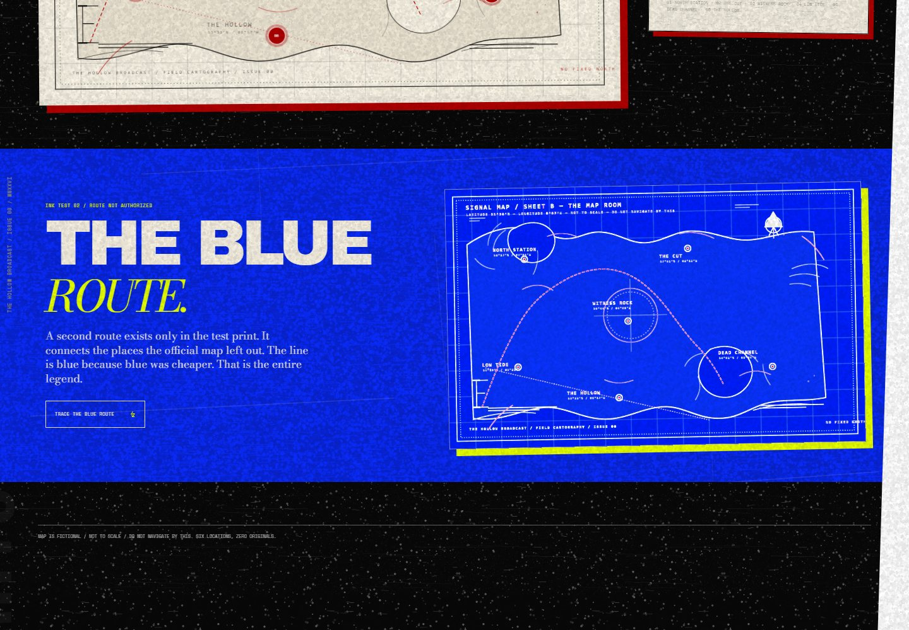

An unauthorised test print at the bottom of the map room: electric blue,
hand-drawn, and not in the legend.

### APPENDIX C / LAST THINGS

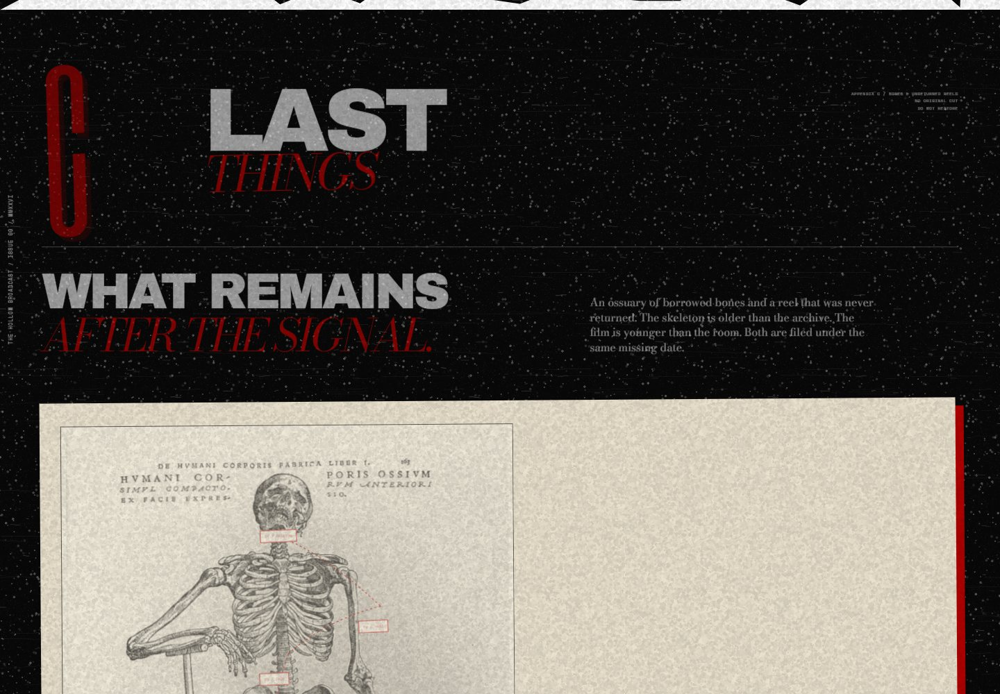

The skeleton is a 1543 Vesalius plate from Wellcome Collection, used under
CC BY 4.0. The reel is original: six frames, two missing, no soundtrack.

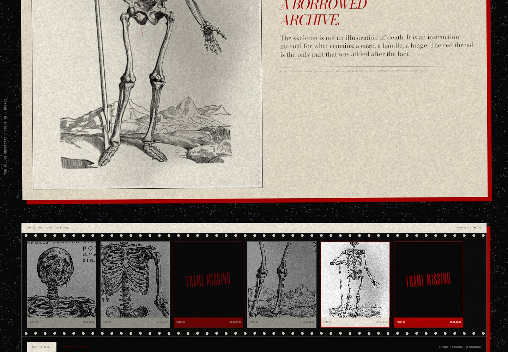

### SOCIAL CARD / 1200 × 630

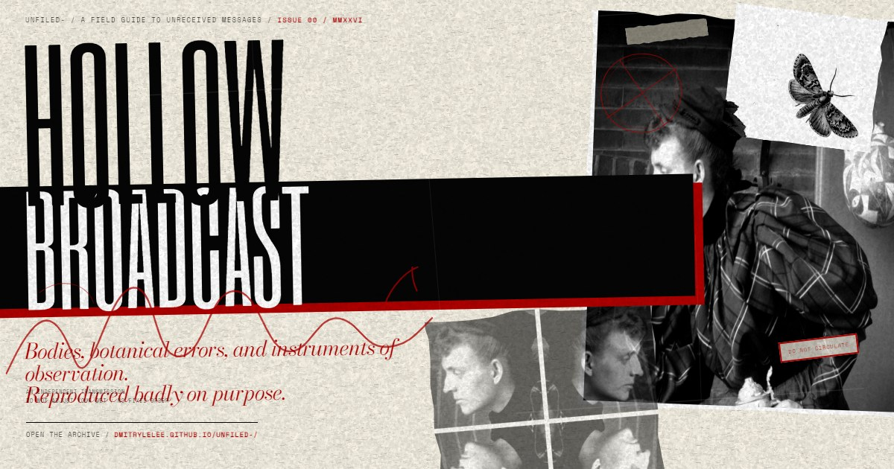

This is the Open Graph / Twitter card used when the publication is shared. The
image is also published as [`assets/og-cover.jpg`](the-hollow-broadcast/assets/og-cover.jpg).

---

## THE MACHINE

Static HTML, CSS and vanilla JavaScript. No build step. No framework. No backend.
No analytics. No cookies. No master.

The only thing stored locally is the audio volume. The room tone, the four
carriers and the interface sounds are synthesized live in the browser; there are
no audio files, no streaming service and no autoplay. Nothing is sent anywhere.

Heavy film flicker and skeletal breathing run only on desktop-class devices.
Reduced-motion users, small screens, low-core/low-memory devices and Save-Data
connections automatically receive the quieter `motion-lite` layer.

The source starts at [`the-hollow-broadcast/index.html`](the-hollow-broadcast/index.html).
The publication is deployed by the GitHub Pages workflow in
[`.github/workflows/deploy.yml`](.github/workflows/deploy.yml) whenever `main`
changes.

### Local viewing

```bash
cd the-hollow-broadcast
python -m http.server 8000
```

Then open `http://localhost:8000/`. A local server is better than opening the
file directly, especially for fonts and browser audio.

---

## SOURCES AND RIGHTS

The photographic and illustrative plates are public-domain or CC0 material from
Wikimedia Commons, cropped, mirrored, converted to black and white and recomposed
for this publication. Exact source pages, makers and licences are in
[`the-hollow-broadcast/SOURCES.md`](the-hollow-broadcast/SOURCES.md).

The paper, xerox, ink, tape, torn-edge and hand-drawn assets are original to this
project. Fonts are distributed under the SIL Open Font License; licence files are
in `the-hollow-broadcast/assets/fonts/licenses/`.

The nine relic plates recompose public-domain and CC0 fragments from the
plates section. The signal map, errata plate and cyanotype blue-route proof are
original. Their cultural references are textual allusions only; no copyrighted
characters, logos, footage or original artwork were used. The referenced works
remain the property of their makers.

The Vesalius skeleton in Appendix C is from Wellcome Collection and is used
under CC BY 4.0; the credit is printed in the section, the colophon and
SOURCES.md. The lost reel is an original interface, not a recovered film.

The writing, layout and code are released without restriction:

**NO RIGHTS RESERVED / NO RIGHTS OBSERVED.**

All text is fiction. Any resemblance to a living signal is intentional.

---

### FILE STATUS

**PUBLISHED / PUBLIC DOMAIN SOURCES / NO FIXED ORDER**

[Live transmission](https://dmitrylelee.github.io/UNFILED-/) ·
[Source](the-hollow-broadcast/) ·
[Production notes](the-hollow-broadcast/README.md) ·
[Sources](the-hollow-broadcast/SOURCES.md)
