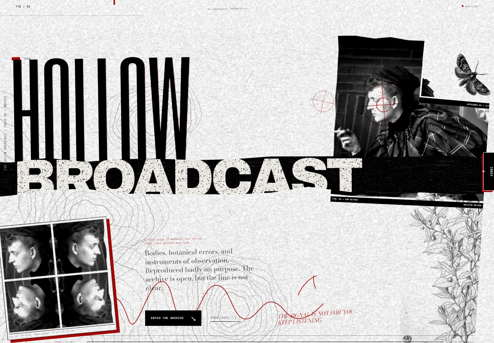
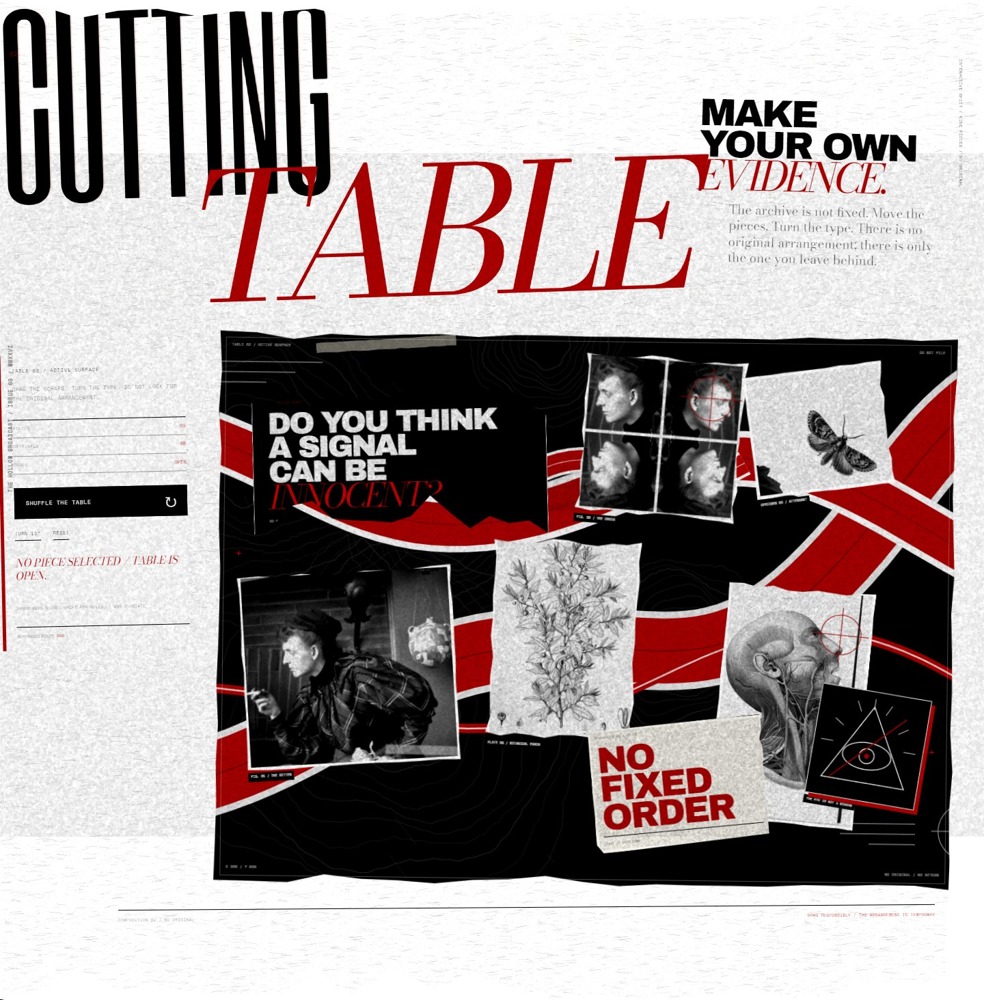
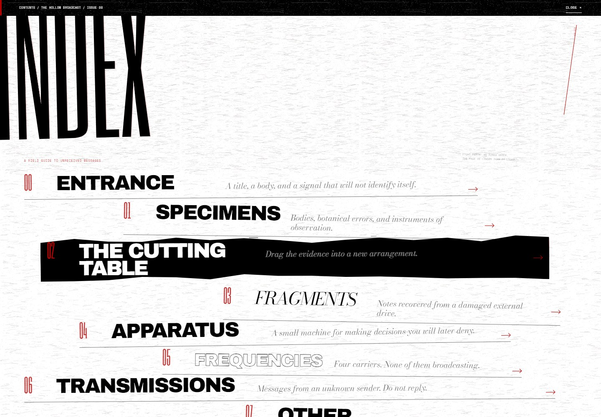

# THE HOLLOW BROADCAST — ISSUE 00







An experimental digital publication disguised as a personal website: a field guide to unreceived messages, assembled from public-domain plates, original typography, red marks, broken grids, sound, and small acts of interface disobedience.

Its visual language sits between early-2000s interface diagrams, high-contrast occult print, photocopied gig-flyer tape, and archival protest typography. The **Cutting Table** turns that language into a working composition object: nine scraps to drag, rotate, shuffle, and leave in a different order.

The page is not a stack of shared section templates. The old uniform section shell and repeated heading row are gone. Every section has its own masthead logic, edge behaviour, scale, density, and collision rules, collected in `chaos.css`. Some pages are printed broadsides; others are contact sheets, faxes, studio boards, or back covers. Jagged section entries, overhanging plates, cropped words, ghost typography, and a red ribbon that crosses a boundary are part of the structure rather than decoration. The index is treated as a loose register, and the specimen reader as a physical file card rather than a generic lightbox.

A separate material layer, `physical.css`, turns the publication into a scanned object. Sections use different torn-paper masks, images are clipped with ripped and cut-out silhouettes, and the page carries paper fibres, toner dust, scanner streaks, halftone dots, ink dropout, misregistered red marks, tape and scratches. The textures, paper silhouettes, tape and hand-drawn marks are original local assets in `assets/textures/`, `assets/paper/`, `assets/illustrations/` and `assets/overlays/`.

Built as a static site for GitHub Pages. No build step. No framework. No backend. No analytics. No cookies.

## What is inside

- **Entrance** — an asymmetric title spread with a photographic sitter, mirrored eye study, moth plate, botanical line art, and hand-drawn signals.
- **Specimens** — seven public-domain plates and three original ink plates (ten total) reworked into an irregular image archive. Click any plate to open its file.
- **The Cutting Table** — an interactive composition board. Drag the photo scraps, turn the type, shuffle the evidence, and leave a different arrangement behind.
- **Fragments** — black-page notes, red corrections, and an anatomical eye diagram pressed into the background.
- **Apparatus** — an interactive sigil engine. Generate marks, read the designation, save the result as an SVG.
- **Frequencies** — four synthesized drone channels built with Web Audio. No mp3 files, no streaming service, no end of track.
- **Cultural Residue** — Appendix A: nine original relic drawings that allude to shared pop-culture objects from the 1980s–2010s without using their original imagery. Click a relic to open its file card.
- **The Map Room** — Appendix B: an original signal map with six interactive field notes, a red route and one incorrect north.
- **Room Tone** — a low, synthesized background hum controlled by the fixed `ROOM TONE [S]` toggle. It starts on click, never autoplays, and can be stopped at any time.
- **Transmissions** — a local random message receiver with a scrambled type-in effect and a three-entry log.
- **Other Worlds** — six real external archives and libraries, presented without an algorithm.
- **Colophon** — sources, type, production notes, and the end of the transmission.

Also included: a custom **404 offprint**, a keyboard shortcut (`I`) for the index, a small moth secret, `prefers-reduced-motion` support, and responsive layouts that keep the collage logic on small screens instead of turning everything into cards.

## GitHub Pages

The folder is ready to publish as-is. `index.html` must sit at the publishing root.

1. Create a public repository, for example `the-hollow-broadcast`.
2. Upload the **contents** of this folder to the repository root.
3. Open **Settings → Pages**.
4. Under **Build and deployment**, choose **Deploy from a branch**.
5. Select the `main` branch and the `/ (root)` folder, then save.
6. The site will appear at `https://<username>.github.io/<repository>/`.

If the repository is named `<username>.github.io`, the site will appear at `https://<username>.github.io/`.

Using the terminal:

```bash
cd the-hollow-broadcast
git init
git add .
git commit -m "the hollow broadcast, issue 00"
git branch -M main
git remote add origin https://github.com/<username>/<repository>.git
git push -u origin main
```

Then enable Pages in the repository settings.

`.nojekyll` is included, so GitHub Pages serves the files directly instead of running Jekyll.

### Note on the 404 page

`404.html` includes a tiny base-path script so its styles and images continue to work when GitHub Pages serves it from a nested URL on a project site. It does not need configuration.

### Social preview

`assets/og-cover.jpg` is referenced with relative paths in the `<head>`. After deployment, replace those two paths with absolute URLs if you want reliable link previews across social platforms:

```html
<meta property="og:image" content="https://<username>.github.io/<repository>/assets/og-cover.jpg">
<meta name="twitter:image" content="https://<username>.github.io/<repository>/assets/og-cover.jpg">
```

## Local preview

From this folder:

```bash
python -m http.server 8000
```

Open `http://localhost:8000/`.

A local server is better than opening `index.html` directly, especially for the Web Audio section and the font loading behaviour.

## Editing the publication

| What | Where |
| --- | --- |
| All section text, labels, captions, credits | `index.html` |
| Base palette, type scale, components | `style.css` — the `:root` block and shared parts |
| Per-section composition, overlaps, edge bleeds | `chaos.css` — the layout logic for each section and breakpoint |
| Torn paper, xerox, tape, ink and image masks | `physical.css`; `assets/textures/`, `assets/paper/`, `assets/illustrations/`, `assets/overlays/` |
| Specimen metadata and long descriptions | `script.js` — the `plates` object |
| Cutting-table piece positions | `index.html` — each `.scrap` has `data-x`, `data-y`, `data-rot`, `data-w`, plus matching inline custom properties |
| Audio channel names, descriptions, tuning | `script.js` — the `channels` array |
| Relic names, references, descriptions | `script.js` — the `relics` object |
| Relic illustrations | `assets/svg/relic-*.svg` |
| Map locations and field notes | `script.js` — the `mapNodes` object |
| Signal map | `assets/svg/signal-map.svg` |
| Random transmission messages | `script.js` — the `transmissionMessages` array |
| Sigil words and instructions | `script.js` — the `sigilSubjects`, `sigilVerbs`, `sigilObjects`, and `sigilInstructions` arrays |
| Images | `assets/img/` |
| Fonts | `assets/fonts/` and `assets/fonts.css` |
| 404 page | `404.html` |
| Social preview image | `assets/og-cover.jpg` |
| README preview images | `preview.jpg`, `preview-table.jpg`, `preview-index.jpg` |

The design is built around four typefaces:

- **Six Caps** — very tall condensed display.
- **Archivo Black** — heavy industrial headline.
- **Bodoni Moda** — editorial serif and italics.
- **Space Mono** — captions, metadata, and machine speech.

All are self-hosted in WOFF2 format with broad fallbacks in the CSS. If external font services are unavailable, the page still works.

### Interactions

- Click **INDEX** (or press `I`) to open the contents overlay.
- Click any specimen to open the plate reader; use previous/next inside the dialog. The reader now includes three original ink plates: THE HAND, THE WHEEL, and THE SPIRAL.
- In Fragments, press **CUT THE TEXT** to assemble a new line from a local pool of fragments. Nothing is saved.
- In **The Cutting Table**, drag any scrap with a mouse or a finger. Use **SHUFFLE THE TABLE** for a new arrangement, **TURN 15°** to rotate the selected scrap, and **RESET** to return to the printed state. With a scrap focused, arrow keys nudge it, `[` and `]` rotate it, and Shift makes nudges larger.
- In **Apparatus**, use **DRAW A MARK** to generate a new sigil, and **SAVE SVG** to download it.
- In **Frequencies**, select a channel, press play, and adjust volume. When you scroll away from the section, a small fixed frequency flag appears so you can stop the sound.
- Press **ROOM TONE [S]** for a low synthesized room hum. It is generated in the browser, starts only on user action, and stops with a second press.
- Open **CULTURAL RESIDUE** (Appendix A) and click any relic to open its reader; use previous/next inside the dialog.
- In **THE MAP ROOM** (Appendix B), select a numbered marker to read its field note, or press **TRACE THE ROUTE** to cycle through all six coordinates.
- In **Transmissions**, press **RECEIVE TRANSMISSION** to generate a new message.
- Three touches on the moth produce a small, unnecessary event.
- The audio volume is remembered in `localStorage`. Nothing else is stored, and nothing is sent anywhere.

## Sources and licensing

All sourced photographic and illustrative plates are public-domain or CC0 material from Wikimedia Commons and were cropped, converted to high-contrast black and white, and recomposed for this publication. Three additional plates — THE HAND, THE WHEEL, and THE SPIRAL — are original ink drawings made for this publication. The torn-paper, xerox, ink, tape and hand-drawn assets are original to this project.

See [SOURCES.md](SOURCES.md) for the exact source pages, creators, and licences.

Fonts are distributed under the SIL Open Font License; the licence files are in `assets/fonts/licenses/`.

The nine relic drawings and the signal map are original. Their pop-culture references are textual allusions only; no copyrighted characters, logos, footage, or original artwork are used. The referenced works remain the property of their makers.

The original writing, layout, code, and generated sigils are released without restriction: **NO RIGHTS RESERVED / NO RIGHTS OBSERVED.**

All text in the publication is fiction. Any resemblance to a living signal is intentional.
